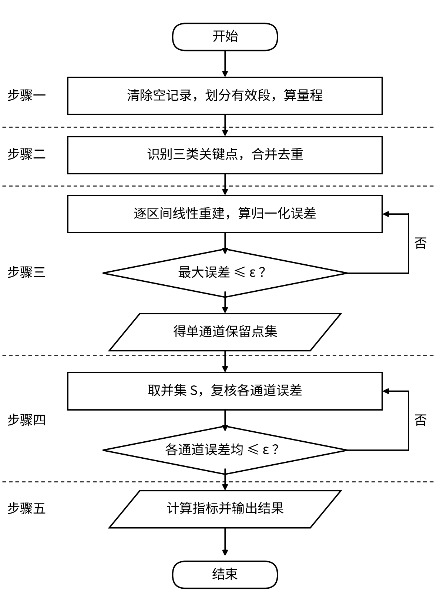
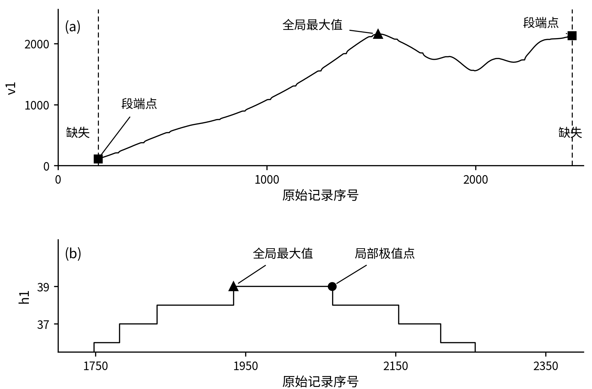
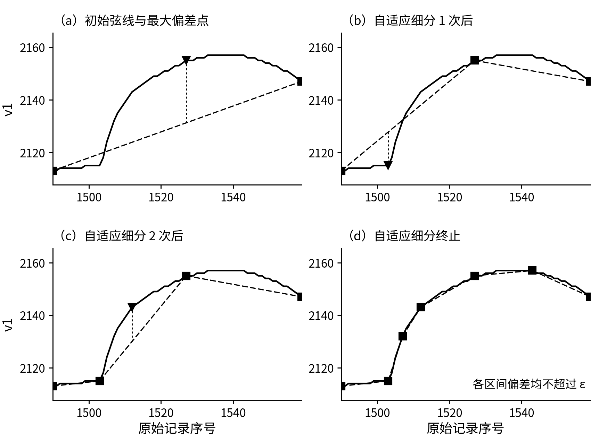
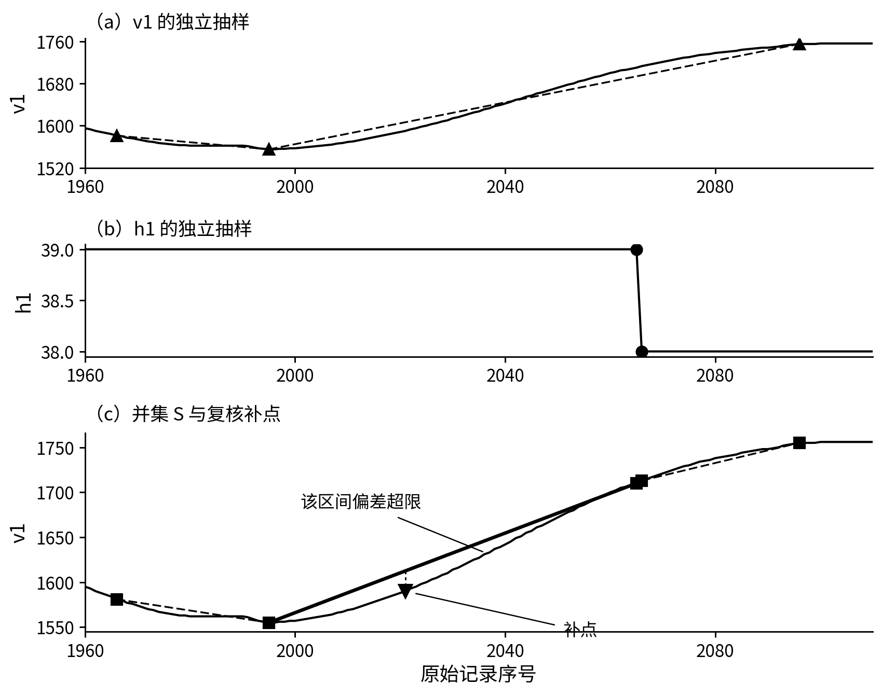
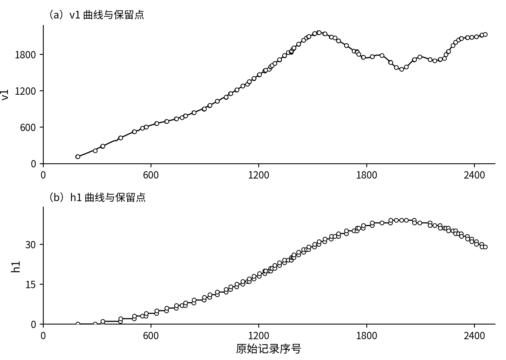
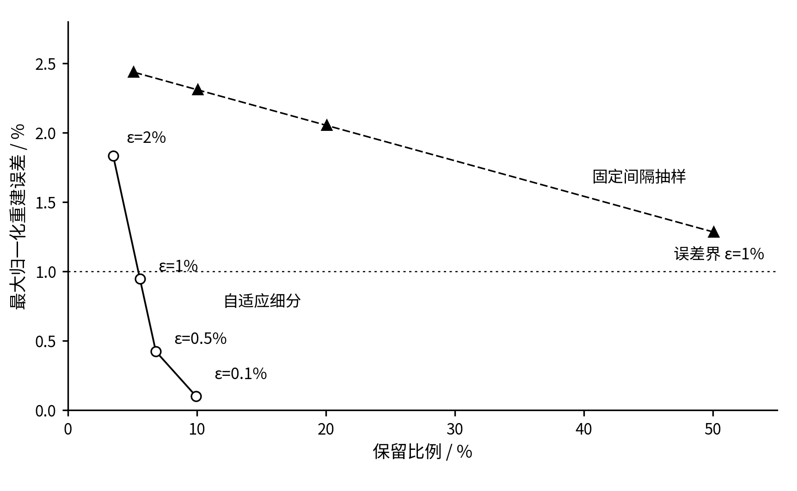

<h1 align="center">Telemetry Adaptive Sampling</h1>

<p align="center">
  <b>Feature-preserving, error-bounded downsampling for multi-channel flight telemetry</b><br>
  <sub>Reduces a telemetry stream by ~90 % while keeping the reconstruction error under a bound you choose — and the peaks engineers actually read.</sub>
</p>

<p align="center">
  
</p>

---

## TL;DR

| | Fixed step-10 sampling | **This method** (ε = 0.1 %) |
|---|---:|---:|
| Records kept | 229 | **226** |
| Retention | 10.09 % | 9.96 % |
| Max reconstruction error | 2.308 % | **0.098 %** |
| Normalised RMSE | 0.356 % | **0.020 %** |

Same data volume, **~24× lower worst-case error**. Get the same numbers on your machine in one command:

```bash
python -m pip install -r requirements.txt
python src/run_analysis.py
```

---

## INTRODUCTION

Flight telemetry is recorded at a fixed frame rate: every channel is sampled every
frame, and every frame carries **all** channels at once. At 100 fps, 500 channels
and 16 bit, ten minutes of flight gives

$$
B = f_s \cdot T \cdot M \cdot b = 100 \times 600 \times 500 \times 16
  \approx 4.8 \times 10^{8}\ \text{bit} \approx 60\ \text{MB} \approx 800\ \text{kbit/s}
$$

which is more than a narrow downlink can carry once other services share the band.

The usual answer is to keep every *n*-th record. It is trivial, it needs no model,
and it is also why transient events get smoothed away — a uniform step does not
know where the curve actually bends. Ignition, stage separation and maximum
dynamic pressure are exactly where the curve bends hardest and where a uniform
sampler spends the fewest points.

This project does something else: **choose which records to keep so that the
reconstructed curve stays within a given error bound, while the few points that
carry the flight story survive.**

## PROBLEM TO DETERMINE

Given a multi-channel telemetry recording and an error bound ε, decide

1. **which records to keep** so that linear reconstruction stays within ε for
   *every* channel and *every* record, and
2. **how few** records that takes, without losing the local extrema, trend changes
   and segment endpoints that engineers read the data for.

Three properties make this harder than plain downsampling:

| Constraint | Consequence |
|---|---|
| Telemetry is frame-based | Keeping one record keeps **all** channels; channels cannot be sampled independently |
| Channel ranges differ by orders of magnitude | A single absolute threshold is meaningless across channels |
| Missing segments exist | Interpolation must not bridge a gap |

## METHOD

<p align="center">
  
</p>

The whole pipeline lives in [`src/run_analysis.py`](src/run_analysis.py).

**Step 1 — Clean and segment.** Drop fully-empty rows, index records by position
(the `t` column is rounded to whole seconds, so ten frames share one timestamp),
split each channel into contiguous valid segments, and compute each channel's
range `R_c` for normalisation.

**Step 2 — Anchor on key features.** Take segment endpoints, local extrema
(first-difference sign changes with a 0.005·R_c dead band) and global extrema as
the initial anchor set.

**Step 3 — Adaptive subdivision.** For every interval fit a chord, measure the
normalised deviation `e_i = |y_i − ŷ_i| / R_c`, and if `max e_i > ε` split at the
worst record and recurse on both halves.

**Step 4 — Merge channels and re-check.** Union all per-channel point sets.
Because the union changes every channel's intervals, recompute the error on the
shared set and **add points** until all channels satisfy ε again.

**Step 5 — Score the result.** Retention ratio, max normalised error, normalised
RMSE, entropy ratio and KL divergence — geometry and distribution checked
separately.

## RESULTS

Public Starship launch telemetry, OCR'd from the broadcast overlay: 10 fps,
2 672 raw records → 2 516 after cleaning → **2 270** with at least one valid
channel. `v1` spans 2 045 units, `h1` spans 39, each a single contiguous segment.

| Metric | Fixed step 10 | This method (ε = 0.1 %) |
|---|---:|---:|
| Records kept | 229 | **226** |
| Retention | 10.09 % | 9.96 % |
| Max normalised error | 2.308 % | **0.098 %** |
| Normalised RMSE | 0.356 % | **0.020 %** |
| Entropy ratio (v1) | 100.03 % | 95.03 % |
| KL divergence (v1) | 0.0050 | 0.1433 |

Loosening the bound to ε = 1 % drops the count to **127** records (5.59 %) at
0.945 % error — still better than a uniform sampler keeps at 229 records.

| | |
|---|---|
|  |  |
| Valid segments and key features | Adaptive subdivision at work |
|  |  |
| Multi-channel union and re-fill | Original curve vs. retained points |

<p align="center">
  <br>
  <sub>Retention vs. worst-case error. Every uniform-sampling point sits above the ε = 1 % line; adaptive sampling crosses it at 5.6 % retention.</sub>
</p>

Storage of the same cleaned set: CSV 40 097 B · Gzip CSV 10 385 B ·
Parquet/Zstd 13 501 B. The 226-record sample is 3 858 B as CSV, 1 451 B gzipped
(9.6 % / 3.6 % of the full cleaned CSV).

## QUICK START

```bash
git clone https://github.com/yydshadaoke/telemetry-adaptive-sampling.git
cd telemetry-adaptive-sampling
python -m pip install -r requirements.txt
python src/run_analysis.py
```

`numpy`, `scikit-learn` and `matplotlib` are required; `pyarrow` (Parquet) and
`fonttools` (font check) are optional. The script exits with status 2 rather than
overwriting previous results with an incomplete run; `--allow-partial` relaxes
that.

## DATA

[chrisjbillington/starship_telemetry](https://github.com/chrisjbillington/starship_telemetry)
— telemetry region of the public launch broadcast, OCR'd at 10 fps. The raw CSV is intentionally
not redistributed here; download it from the upstream repository and place it at
`data/raw/telemetry-10fps.csv`.
